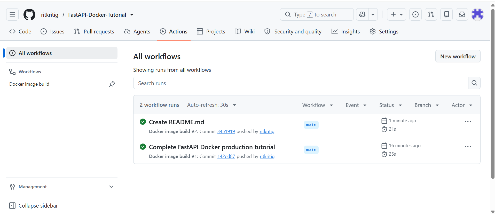
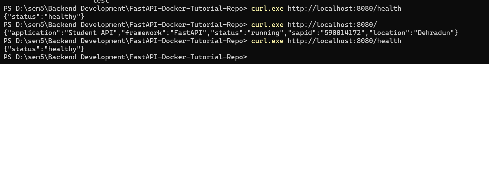

# FastAPI Docker Tutorial

This project demonstrates the complete workflow of containerizing a FastAPI application using Docker and progressing from a local containerized application to an automated CI/CD pipeline with monitoring, horizontal scaling, and Nginx load balancing.

## Technologies Used

- Python
- FastAPI
- Uvicorn
- Docker
- Docker Hub
- GitHub Actions
- Nginx
- PowerShell

## Project Structure

```text
FastAPI-Docker-Tutorial/
├── .github/
│   └── workflows/
│       └── ActionsYaml.yaml
├── .gitignore
├── Dockerfile
├── main.py
├── nginx.conf
├── requirements.txt
└── README.md
```

## 1. FastAPI Student API

The project contains a FastAPI Student API with the following endpoints:

| Method | Endpoint | Description |
|---|---|---|
| GET | `/` | Displays application information and status |
| GET | `/health` | Returns the health status of the API |
| GET | `/students` | Returns the student list |

The application also includes middleware for structured request logging. Each request records information such as:

- HTTP method
- Request path
- Response status
- Request duration

Example:

```text
INFO method=GET path=/health status=200 duration_ms=0.55
```

## 2. Docker Containerization

The application is containerized using a Dockerfile based on Python 3.12 Slim.

Build the image:

```bash
docker build -t ritkriti/fastapi-app:v0.1 .
```

Run the image:

```bash
docker run --rm -p 8000:8000 ritkriti/fastapi-app:v0.1
```

Test the API:

```bash
curl http://localhost:8000/health
curl http://localhost:8000/students
```

Expected health response:

```json
{"status":"healthy"}
```

## 3. Docker Hub

The Docker image is published to Docker Hub as:

```text
ritkriti/fastapi-app:v0.1
```

The image can be downloaded using:

```bash
docker pull ritkriti/fastapi-app:v0.1
```

### Docker Hub Output


## 4. CI/CD with GitHub Actions

The repository contains a GitHub Actions workflow under:

```text
.github/workflows/ActionsYaml.yaml
```

Whenever code is pushed to the `main` branch, the workflow automatically:

1. Checks out the repository.
2. Logs in to Docker Hub using GitHub Secrets.
3. Builds the Docker image.
4. Pushes the updated image to Docker Hub.

Docker Hub credentials are securely stored using repository secrets instead of being included directly in the source code.

### Successful GitHub Actions Workflow



## 5. Structured Logging and Monitoring

The FastAPI application records structured logs for incoming requests.

Traffic can be generated using:

```powershell
1..20 | ForEach-Object { Invoke-WebRequest http://localhost:8000/health -UseBasicParsing | Out-Null }
```

Container logs can then be inspected using:

```bash
docker logs -f <container-name>
```

Example output:

```text
INFO method=GET path=/health status=200 duration_ms=0.55
INFO method=GET path=/health status=200 duration_ms=0.60
INFO method=GET path=/health status=200 duration_ms=0.52
```

### Structured Logging Output


## 6. Response Time Measurement

The response time of the API can be measured using PowerShell:

```powershell
Measure-Command { curl.exe -s http://localhost:8000/students }
```

This helps observe application response time and provides a basic demonstration of backend monitoring.

## 7. Horizontal Scaling

Two independent instances of the same FastAPI Docker image are run simultaneously:

```bash
docker run -d --name fastapi-1 -p 8001:8000 ritkriti/fastapi-app:v0.1

docker run -d --name fastapi-2 -p 8002:8000 ritkriti/fastapi-app:v0.1
```

The two instances can be tested independently:

```bash
curl http://localhost:8001/health
curl http://localhost:8002/health
```

Both containers internally use port `8000`, while the host exposes them through ports `8001` and `8002`.

### Multiple FastAPI Instances


## 8. Nginx Load Balancing

Nginx is used as a load balancer in front of the two FastAPI instances.

The architecture is:

```text
                    ┌── FastAPI Instance 1 :8001
Client → Nginx :8080
                    └── FastAPI Instance 2 :8002
```

The `nginx.conf` file defines both FastAPI instances as upstream servers.

Nginx is started using:

```powershell
docker run -d --name student-lb -p 8080:8080 -v "${PWD}/nginx.conf:/etc/nginx/nginx.conf:ro" nginx:alpine
```

Requests are then sent through the load balancer:

```bash
curl http://localhost:8080/health
```

Multiple requests through port `8080` are distributed between the two FastAPI containers.

### Nginx Load Balancing


## 9. End-to-End CI/CD Verification

A visible change was made to the FastAPI application's root endpoint and pushed to GitHub.

The push triggered GitHub Actions, which rebuilt the Docker image and pushed the updated image to Docker Hub.

The updated image was then pulled and executed locally.

Final API response:

```json
{
  "application": "Student API",
  "framework": "FastAPI",
  "status": "running",
  "sapid": "590014172",
  "location": "Dehradun"
}
```

Health verification:

```json
{"status":"healthy"}
```

### Final Output



## Workflow Summary

```text
Code Change
    ↓
Git Push
    ↓
GitHub Actions
    ↓
Docker Image Build
    ↓
Docker Hub
    ↓
Pull & Run Container
    ↓
Monitoring
    ↓
Horizontal Scaling
    ↓
Nginx Load Balancing
```

## Key Learning Outcomes

This tutorial demonstrates:

- FastAPI backend development
- Docker image creation
- Running and testing Docker containers
- Publishing images to Docker Hub
- CI/CD automation using GitHub Actions
- Secure use of GitHub Secrets
- Health checks and structured logging
- Basic response-time monitoring
- Horizontal container scaling
- Nginx load balancing
- End-to-end CI/CD verification
